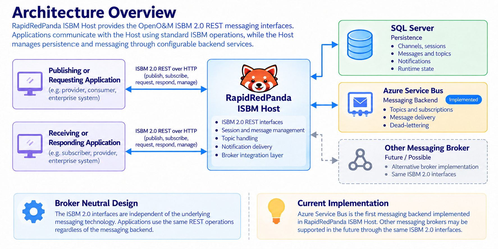

# RapidRedPanda ISBM Host

## What Is RapidRedPanda ISBM Host?

RapidRedPanda ISBM Host provides standardized ISBM 2.0 messaging services for exchanging information between applications. It exposes REST interfaces for channel management, publication/subscription, request/response, and session management.

The project's primary goal is implementing OpenO&M ISBM 2.0 functionality. Developers can use it to explore standardized application messaging, including the messaging model associated with ISA-95 Part 6. Using the Host does not require participating in an OpenO&M integration project.

The current implementation uses .NET 10, SQL Server persistence, and Azure Service Bus messaging. These introductory documents describe functionality found in the source; they do not establish complete ISBM 2.0 compliance or production readiness.

## Why Standardized Messaging?

When applications each introduce their own message submission, retrieval, authentication, and subscription conventions, every integration has another interface to learn and maintain. A common messaging interface lets developers reuse knowledge and client behavior across integrations.

For example, an application can publish an equipment status update while reporting and maintenance applications subscribe to updates relevant to them. The publisher identifies a channel and topics rather than calling each receiving application's individual API.

Standardizing messaging does not automatically standardize business meaning. Applications still need agreements about payload schemas, identifiers, units, and how to interpret a message.

## What Is ISBM 2.0?

[OpenO&M ISBM](https://www.openoandm.org/isbm/) is an implementation specification for the ISA-95 Messaging Service Model. ISBM 2.0 defines concrete service interfaces, with REST and SOAP specifications available. RapidRedPanda currently exposes REST interfaces; these documents do not claim SOAP support.

The main concepts are:

- **Channels:** Named places for publication or request exchanges.
- **Publishers and consumers:** Applications that supply and receive publications.
- **Publication/subscription:** Publishers share messages with interested consumers.
- **Request/response:** A requesting application sends a message, and a responding application returns a related response.
- **Sessions:** Identified contexts for performing messaging operations on a channel.
- **REST interfaces:** HTTP operations through which clients use those services.

Start with [What Is ISBM?](docs/introduction/what-is-isbm.md) for examples.

## What RapidRedPanda Provides

The current source contains implementations for:

| Area | Available functionality |
| --- | --- |
| Channels | Create, list, retrieve, and delete channels; add and remove channel security tokens. |
| Publication/subscription | Open publication and subscription sessions; post, read, remove, and explicitly expire publications. |
| Request/response | Open requester and responder sessions; post, read, remove, and explicitly expire requests; post, read, and remove responses. |
| Sessions | Close messaging sessions. |
| Channel credentials | `UsernameToken` handling and REST HTTP Basic credential parsing. |
| Notifications | Listener callbacks for publication, request, and response availability. |
| Configuration discovery | Retrieve supported-operation information and authenticated security details. |
| Persistence and transport | SQL Server stores Host state; Azure Service Bus provides broker transport used for publications and requests. |

### Current Boundaries

Only `UsernameToken` security tokens are supported. For a supplied flat token containing username and password, an omitted `type` defaults to `UsernameToken`. Omitting the token collection does not create default credentials.

Filter expressions are accepted for compatibility, but are not applied by the server in this release. Supplied expressions must still pass structural validation. Topic selection remains active; receiving applications must perform any required content filtering themselves.

The Host supplies messaging services rather than a CCOM-specific server or a general implementation of ISA-95 information models. See [Core Concepts](docs/introduction/core-concepts.md) for the distinction between topic selection, content filtering, and notifications.

## Architecture Overview

Applications communicate through the Host's ISBM interfaces. SQL Server maintains channels, sessions, message lifecycle state, responses, and notification records. Azure Service Bus supplies the broker transport behind publication and request delivery. The Host also sends optional availability callbacks to application listeners.

See [Architecture](docs/architecture/overview.md) for the component diagram and backend responsibilities.

### Technology Independence

RapidRedPanda ISBM Host implements the OpenO&M ISBM 2.0 REST messaging interfaces independently of the underlying messaging and persistence technologies. ISBM 2.0 defines the application-facing contracts; it does not mandate SQL Server, Azure Service Bus, or any other specific backend technology.

The first release uses Microsoft SQL Server for persistent storage and Azure Service Bus for broker-based messaging. These are the only currently supported backends. Future RapidRedPanda implementations may support alternative messaging brokers or relational databases while retaining the same application-facing ISBM contracts, but no other backend is implemented or documented as compatible in this release.

## Getting Started

The current implementation requires a .NET 10 development environment, SQL Server, and an Azure Service Bus namespace supporting topics and subscriptions, together with appropriate configuration and access permissions.

Follow the [Getting Started guide](docs/getting-started/README.md) for Windows prerequisites, installation, configuration, and a first JSON publication. These instructions are source-reviewed drafts, not end-to-end validated deployment steps. Docker deployment is deferred to a future release.

## Documentation

The [documentation index](docs/README.md) also links to security, maintenance, and troubleshooting. Review [Compatibility and Limitations](docs/api/compatibility-and-limitations.md), including the current request-expiry ownership limitation, before planning a shared deployment.

Read these pages in order:

1. [What Is ISBM?](docs/introduction/what-is-isbm.md) explains the problem and messaging patterns.
2. [ISA-95 and ISBM](docs/introduction/isa95-and-isbm.md) explains the standards and implementation layers.
3. [Core Concepts](docs/introduction/core-concepts.md) introduces the vocabulary and current Host behavior.
4. [Integration Options](docs/integration/README.md) introduces ClientAdapter, CLI Wrapper, and direct REST approaches.
5. [Getting Started](docs/getting-started/README.md) covers infrastructure setup and a two-client publication tutorial.
6. [ISBM REST API](docs/api/overview.md) provides shared contracts, channel/session, publication and request/response reference, notifications, configuration discovery, message content, faults, and current compatibility limits.

## Standards and References

- [OpenO&M ISBM specifications and interface definitions](https://www.openoandm.org/isbm/)
- [ISA-95 standards overview](https://www.isa.org/standards-and-publications/isa-standards/isa-95-standard)
- [Microsoft Azure Service Bus overview](https://learn.microsoft.com/en-us/azure/service-bus-messaging/service-bus-messaging-overview)

## License

RapidRedPanda ISBM Host is licensed under the [MIT License](LICENSE).
