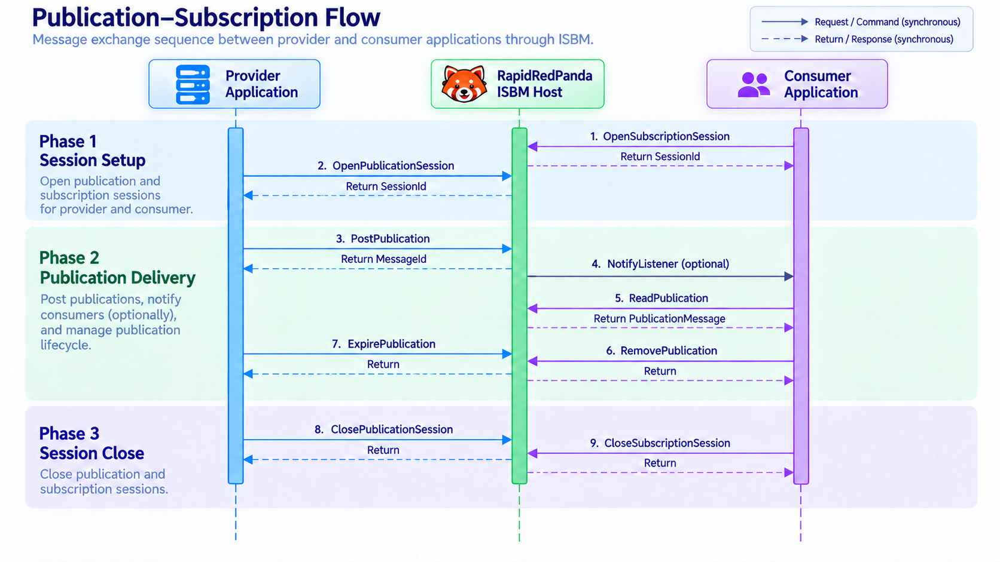

# Publication / Subscription

A publisher posts to a Publication channel. Each already-open consumer subscription selects topics and reads its own deliveries. An optional callback announces availability; the consumer still reads the message through REST.

**Source-reviewed draft:** operation outcomes below come from the implementation. For the full PowerShell walkthrough, use [Your First Message](../getting-started/first-message.md). That tutorial and these contracts have not been exercised end to end against a live Host.

## Workflow



The diagram uses service-operation names, not literal URL paths. Its ExpirePublication step is **optional**, not a required acknowledgment after every consumer read. RemovePublication affects one consumer's outstanding delivery; expiry affects eligibility for later delivery on the channel. Neither retracts content already processed by an application.

1. Create a secured Publication channel.
2. Open a provider publication session and a consumer subscription with matching topics.
3. Wait for the subscription to open before posting.
4. Post a publication using the provider session.
5. Poll using the consumer session, or wait for an optional availability notification before reading.
6. Process the returned content, then remove that consumer's outstanding publication.
7. Close each session when finished; delete only disposable demonstration channels.

Publisher and consumer IDs are distinct. See [Sessions](sessions.md) for opening and closing; all routes below are relative to `/isbm/2.0`.

## Operations

| Operation | Method and path | Success | Request / response |
| --- | --- | --- | --- |
| PostPublication | POST `sessions/{providerSessionId}/publications` | 201 | topics, messageContent, optional expiry; returns messageId. |
| ReadPublication | GET `sessions/{consumerSessionId}/publication` | 200 | No body; returns messageId, topics, messageContent. |
| RemovePublication | DELETE `sessions/{consumerSessionId}/publication` | 204 | No body or message ID; removes this session's outstanding delivery. |
| ExpirePublication | DELETE `sessions/{providerSessionId}/publications/{messageId}` | 204 | No body; marks matching channel publication expired. |

Supply matching Basic channel credentials on protected calls. Singular `publication` belongs to consumer read/removal; plural `publications` belongs to provider post/expiry.

## Posting and Topics

Example post body:

```json
{
  "topics": ["equipment.temperature"],
  "messageContent": {
    "content": {
      "equipmentId": "PUMP-101",
      "temperature": 72.5,
      "status": "Normal"
    }
  },
  "expiry": "PT5M"
}
```

Expected HTTP 201 body:

```json
{
  "messageId": "22222222-2222-4222-8222-222222222222"
}
```

Use the actual returned messageId. The Host generates it; no caller-supplied idempotency key is documented here. See [Message Content](message-content.md) for alternate payload representations.

Topics must be a nonempty array of nonblank strings without surrounding whitespace. Duplicate exact values are removed. Publication posting accepts at most **32 distinct topics**. Topic selection is case-sensitive and matches an intersection: any common topic can select a publication. It is not XPath/content filtering or a wildcard topic-language guarantee.

A subscription opened after posting does not acquire the earlier message retroactively. Subscribe before posting and coordinate readiness between clients.

### Duration Expiry

Expiry is a duration string such as `PT5M`, not a timestamp. Positive durations set broker time-to-live and the Host's recorded effective expiry. Malformed/overflowing durations return ParameterFault.

Omitted/null/blank expiry, and parsed zero or negative durations, currently leave the explicit lifetime unset. They do not immediately expire the publication. Omit expiry to use backend defaults, or use a positive duration; use ExpirePublication for explicit expiry. An unset lifetime does not promise indefinite broker retention.

## Reading and Removal

Expected HTTP 200 body:

```json
{
  "messageId": "22222222-2222-4222-8222-222222222222",
  "topics": ["equipment.temperature"],
  "messageContent": {
    "content": {
      "equipmentId": "PUMP-101",
      "temperature": 72.5,
      "status": "Normal"
    }
  }
}
```

The current controller does not populate expiry in publication read responses; do not rely on a remaining-lifetime field.

No available publication returns HTTP **404**, with:

```json
{
  "fault": "MessageFault"
}
```

Retry polling only this expected empty-read result, with an application-appropriate delay and timeout. ChannelFault, SessionFault, or other failures are not normal empty reads. An individual read can wait on the broker; a poll-count limit is not an exact elapsed-time bound.

Reading establishes/returns the consumer's outstanding publication; repeated reads can return it until it is removed. Process it before calling RemovePublication. Do not run concurrent read/process/remove loops on the same session expecting independent message contexts.

Removal has no messageId in the route. It updates the Host's outstanding recipient state and settles a matching broker delivery when one is held. It is not a deletion from every subscriber and is distinct from closing the session or deleting the channel. A valid consumer session with no outstanding publication can return 204 as a no-op.

Remove promptly after processing. Durable Host state and a broker delivery lock are different mechanisms; this reference does not establish complete lock-renewal, restart, or multi-instance guarantees.

## Explicit Expiry

Use an authorized provider publication session on the same channel and the actual publication messageId. The current implementation matches expiry by channel and message ID, not exclusively by the original posting session.

After marking a publication expired, pending deliveries are excluded from new outstanding claims and expired broker deliveries can be skipped. **An already outstanding publication can still be returned by a later read**, and expiry cannot undo work already performed by a consumer.

With a valid, authorized open provider session, unknown or other-channel message IDs are no-action successes (204), not proof that a publication existed or was expired. Malformed message IDs still fail validation. Do not use this route to check message existence.

## Errors and Retry Safety

| Condition | Source-derived outcome |
| --- | --- |
| Invalid body, topics, content, or malformed expiry | 400 ParameterFault |
| Unsupported/missing message envelope Content-Type | 415; framework response, not guaranteed ISBM fault JSON |
| Invalid/unavailable/unauthorized session | 404 SessionFault in the registered authorization path |
| Wrong session role | 422 OperationFault |
| No publication ready on consumer read | 404 MessageFault |
| Provider post cannot resolve its channel | 404 ChannelFault |
| SQL/broker or unexpected failure | 500 OperationFault |

Transport checks can precede these operation outcomes; see [Fault Handling](fault-handling.md).

Publishing sends to Azure Service Bus before recording metadata in SQL. A failure/timeout is therefore not proof that no message was delivered. Blind retries can produce duplicates. Consumers should have an application-level duplicate-processing strategy; the Host does not promise exactly-once business processing.

A successful callback is not an acknowledgment that the consumer processed the message. Closing a consumer deletes its broker subscription; finish processing first. Deleting a channel affects all clients using that channel.

Return to [API Overview](overview.md) or [Compatibility and Limitations](compatibility-and-limitations.md).

