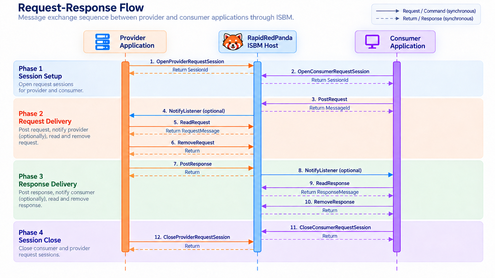

# Request / Response

A **consumer request session** belongs to the requester. A **provider request session** belongs to the responder. Both use a Request channel. These roles differ from publication publisher/subscriber sessions.

**Source-reviewed draft:** contracts and outcomes are implementation-derived, not live results. Use [Complete REST Request/Response Tutorial](../getting-started/first-request-response.md) for a two-client JSON walkthrough.

## Workflow and Correlation



The diagram uses service names, not literal REST paths. Its RemoveRequest-before-PostResponse order works **while the request remains active**: removal acknowledges that responder's delivery, not deletion of the request's correlation record. The tutorial posts the response before removing the request to keep it outstanding through submission. Neither ordering guarantees that the requester can read a response after request expiry.

The diagram's synchronous arrows describe individual REST calls and their returns; this is not one synchronous RPC call that waits for the entire business response. Callback notices are optional availability signals, not payload delivery.

1. Create a secured Request channel.
2. Open a responder session selecting topics before posting any request.
3. Open the requester's consumer request session.
4. Post a request; retain the returned request message ID.
5. Read the request using the responder session; retain its message ID for correlation.
6. Post a response against that request ID, then acknowledge the responder's request delivery.
7. Read and process the response using the original requester session and request ID, then remove the outstanding response.
8. Expire the request when your exchange is finished, close sessions, and delete only disposable example channels.

Multiple matching responder subscriptions can receive a request. The interface is not a guarantee of single-responder work distribution. A request can have multiple responses, including responses from repeated submissions; clients must define how many responses they expect and how they handle duplicates.

## Routes

All paths are relative to `/isbm/2.0`. Encode channel URIs as described in [API Overview](overview.md).

| Operation | Method and path | Role | Success |
| --- | --- | --- | --- |
| OpenConsumerRequestSession | POST `channels/{channelUri}/consumer-request-sessions` | Requester | 201 with sessionId |
| OpenProviderRequestSession | POST `channels/{channelUri}/provider-request-sessions` | Responder | 201 with sessionId |
| PostRequest | POST `sessions/{consumerSessionId}/requests` | Requester | 201 with messageId |
| ReadRequest | GET `sessions/{providerSessionId}/request` | Responder | 200; empty read is 404 MessageFault |
| RemoveRequest | DELETE `sessions/{providerSessionId}/request` | Responder | 204, no body |
| PostResponse | POST `sessions/{providerSessionId}/requests/{requestMessageId}/responses` | Responder | 201 with new response messageId |
| ReadResponse | GET `sessions/{consumerSessionId}/requests/{requestMessageId}/response` | Requester | 200; no available response is 404 MessageFault |
| RemoveResponse | DELETE `sessions/{consumerSessionId}/requests/{requestMessageId}/response` | Requester | 204, no body |
| ExpireRequest | DELETE `sessions/{consumerSessionId}/requests/{messageId}` | Requester | 204, no body |
| CloseSession | DELETE `sessions/{sessionId}` | Either | 204, no body |

Use appropriate Basic channel credentials on protected calls. The request ID in response paths is **not** the response messageId. RemoveResponse selects the outstanding response for that requester/request pair; it does not take a response ID.

## Session Opening

Both roles require a Request channel. The opening response has a generated sessionId as in [Sessions](sessions.md).

Requester body:

```json
{}
```

The only supported requester-opening field is optional `listenerUrl`, for response availability notices. Topics belong on PostRequest, not on this opening body. An explicit empty object is the recommended portable body when polling; some empty-body forms are accepted, but do not rely on identical handling across transfer modes.

Responder body:

```json
{
  "topics": ["equipment.status.request"]
}
```

Optional responder fields are `listenerUrl` (request availability) and `filterExpressions`. Topic, listener URL and filter-structure rules are the same as the [subscription rules](sessions.md). Filters are accepted/persisted but not evaluated. The generated broker filter has a 1024-character limit; it is not a blanket 32-topic responder-subscription limit.

A responder session creates a Host-managed Azure Service Bus subscription. Open it before posting; it does not retroactively receive requests sent before its subscription existed.

## Post and Read a Request

PostRequest example:

```json
{
  "topics": ["equipment.status.request"],
  "messageContent": {
    "content": {
      "equipmentId": "PUMP-101",
      "action": "ReadStatus"
    }
  },
  "expiry": "PT30M"
}
```

Expected HTTP 201 body:

```json
{
  "messageId": "33333333-3333-4333-8333-333333333333"
}
```

This messageId becomes requestMessageId for response operations. Do not supply a publication session or use a response ID here.

PostRequest supports up to 32 distinct nonblank, unpadded topics, with case-sensitive intersection matching. MessageContent uses the same [native JSON / text / binary representations](message-content.md) as publications.

A positive duration sets broker/Host request lifetime. Omitted/null/blank or parsed nonpositive duration leaves explicit lifetime unset, not immediate expiry or guaranteed permanent retention. Malformed duration parsing returns ParameterFault. The tutorial uses 30 minutes to allow manual coordination, not as a Host default.

ReadRequest expected body:

```json
{
  "messageId": "33333333-3333-4333-8333-333333333333",
  "topics": ["equipment.status.request"],
  "messageContent": {
    "content": {
      "equipmentId": "PUMP-101",
      "action": "ReadStatus"
    }
  }
}
```

The current durable request read reports its recorded recipient topic; do not assume the response echoes the entire original multi-topic post. The controller does not populate expiry in the read response.

Reading returns/retains an outstanding request for that responder. Repeated reads can return the same content until RemoveRequest, including already-outstanding content after expiry. Serialize read/process/remove work within one session.

RemoveRequest has no message ID or body. It marks this responder's outstanding recipient removed and settles a matching held broker delivery. It does not delete the requester's request or responses. With a valid open responder session and no outstanding request, removal can be a 204 no-op.

## Posting a Correlated Response

Use the messageId obtained from ReadRequest in the response URL. Body:

```json
{
  "messageContent": {
    "content": {
      "equipmentId": "PUMP-101",
      "status": "Normal",
      "temperature": 72.5
    }
  }
}
```

Response bodies have no routing topics or expiry field in this contract. The URL supplies correlation. Successful post returns HTTP 201 with a **new response** messageId.

Eligibility is current-implementation behavior:

- A matching unexpired request on the responder's channel can receive a response. This check does not require an outstanding claim by that responder for an active request; application code should still respond only to requests it has received and is responsible for.
- An expired request can also pass eligibility if it is still outstanding for that responder session.
- Unknown, cross-channel, or expired-without-that-outstanding-context requests create no response. The controller returns **404 MessageFault**, not 204, for this no-action result.
- Eligibility checking and SQL response insertion are not a promise of an atomic expiry decision across concurrent calls.

Responses are persisted in SQL rather than sent as another request broker message. A 201 means a response was created, not that it was received or processed. Repeating PostResponse can create another response; no caller idempotency key or one-response-only guarantee is documented.

## Reading and Removing Responses

Expected ReadResponse body:

```json
{
  "requestMessageId": "33333333-3333-4333-8333-333333333333",
  "messageId": "44444444-4444-4444-8444-444444444444",
  "messageContent": {
    "content": {
      "equipmentId": "PUMP-101",
      "status": "Normal",
      "temperature": 72.5
    }
  }
}
```

Only the original requester session can read/remove responses for its request. An unknown request ID or a request belonging to another requester session maps to **404 SessionFault**, not an empty-read MessageFault.

For a known owned request, no response ready returns 404 MessageFault. An outstanding response is returned again until removed. After removal, another read can claim the next unremoved response in insertion order while the request is active.

RemoveResponse acknowledges the current outstanding response for the requester/request pair. With an owned request and no outstanding response, it can return 204 as a no-op. It does not delete every response or expire the request.

Polling 404 MessageFault must be bounded. On response reads it can mean no response yet **or no new response eligible after expiry**; it is not an invitation to wait indefinitely. Track the application's deadline.

## Expiry Is Not Retraction

Explicit ExpireRequest targets the requester's own session/channel/message. A 204 does not prove that a matching request existed; a valid GUID with no owned match can return success. Expire only IDs your client obtained for its own requests; do not treat unmatched IDs as a harmless probe.

Expiry prevents new request delivery claims and new response claims. Already-outstanding requests and responses can remain readable, and a responder with an outstanding expired request can still create a response. **That new response need not be claimable by the requester after expiry.**

Expiry cannot undo application work. Request removal, response removal, expiry, and session close are separate lifecycle operations. Complete response consumption before expiring/closing the example exchange.

## Faults and Retry Boundaries

| Condition | Source-derived outcome |
| --- | --- |
| Invalid opening/body/topics/content/listener/filter/duration or malformed request message ID | 400 ParameterFault, subject to earlier authorization/transport checks |
| Conflicting filter namespace mapping | 400 NamespaceFault |
| Missing/unauthorized channel at open | 404 ChannelFault |
| Wrong channel type or session role | 422 OperationFault |
| Unavailable/unauthorized/closed/malformed session at authorization gate | 404 SessionFault |
| Empty ReadRequest | 404 MessageFault |
| Owned request with no available ReadResponse | 404 MessageFault |
| Unknown/other-requester request on ReadResponse or RemoveResponse | 404 SessionFault |
| PostResponse has no eligible request | 404 MessageFault; no response created |
| Non-JSON envelope for message post | 415; no guaranteed ISBM fault shape |
| Backend/unexpected failure | 500 OperationFault |

Only empty reads are normal polling cases; a failed PostResponse is not an empty queue to blindly retry.

PostRequest sends to the broker before SQL metadata insertion. An error can follow delivery; blind retries can duplicate requests. PostResponse retries can create multiple response records after an uncertain outcome. Use application-defined correlation/business idempotency and sanitized diagnostics.

See [Fault Handling](fault-handling.md), [Compatibility](compatibility-and-limitations.md), and the [two-client walkthrough](../getting-started/first-request-response.md).

