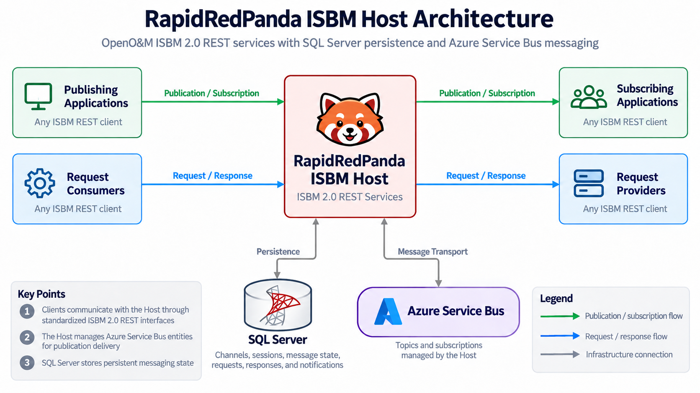
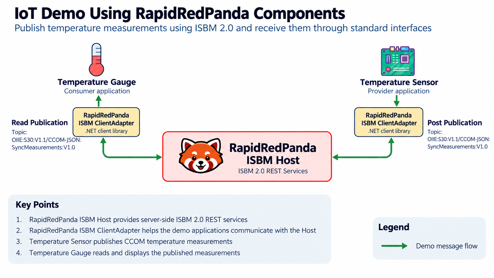

# Architecture

Applications use the Host's [REST API](../api/overview.md), not database tables or broker subscriptions as their public interface.

The arrows summarize logical flow, not every HTTP exchange. Responders also post responses back through the Host; clients retrieve messages through REST. Responses are persisted in SQL; the diagram does not mean every response traverses Service Bus. Optional outbound availability callbacks are not shown.

## Responsibilities

| Component | Responsibility |
| --- | --- |
| Application | Agree on payload schemas/topics, authenticate, process messages, remove deliveries, and handle duplicates/deadlines. |
| Host REST services | Validate contracts, authorize channel/session operations, and coordinate message lifecycles. |
| SQL Server | Persist channels, credentials, sessions, message/response state, recipients, and notification records. |
| Azure Service Bus | Provide publication and request broker transport with Host-managed topics/subscriptions. |
| Background workers | Dispatch availability callbacks and synchronize channel topics. |

SQL and broker actions do not form a promised atomic cross-system transaction. Failures can have partial effects. Applications need explicit retry and deduplication policies; see [Compatibility and Limitations](../api/compatibility-and-limitations.md).

The ISBM REST services are the application-facing interface. SQL Server and Azure Service Bus are implementation backends used by this Host release, not mandatory components of the ISBM standard. Future implementation alternatives could preserve the same ISBM-facing contracts, but this release documents SQL Server and Azure Service Bus as the supported persistence and messaging technologies.

## Messaging Patterns

Publication/subscription distributes messages to sessions selecting matching topics. Request/response correlates responses to a request and can involve multiple responders. Neither requires a particular business model. Follow the [publication](../api/publication-workflow.md) and [request/response](../api/request-response-workflow.md) references for operation order, ownership, and expiry.

Notifications signal availability, not the application payload. Listeners subsequently read through the Host. Retries and races are possible; only HTTP 204 acknowledges a callback. See [Notifications](../api/notifications.md).

## Optional Application Example

This conceptual ecosystem example uses CCOM measurement content and an OIIE-style topic convention. Neither is mandatory. It is not an installed demo or a verified ClientAdapter tutorial bundled with this release. Beginner examples use generic JSON and direct REST; applications in other languages can use the same interfaces.

## Backend Lifecycle

Channel creation and receiving-session operations manage broker entities. Synchronization can recreate missing channel topics, not lost messages or all session subscriptions. SQL records alone do not restore the entire broker state. See [Installation](../getting-started/installation.md#broker-entities-managed-by-the-host) and [Maintenance and Recovery](../operations/maintenance.md).

Credentials, HTTPS endpoints, backend permissions, and callback network access belong to the deployment trust boundary. See [Security and Deployment](../operations/security-and-deployment.md). Return to the [documentation index](../README.md).
