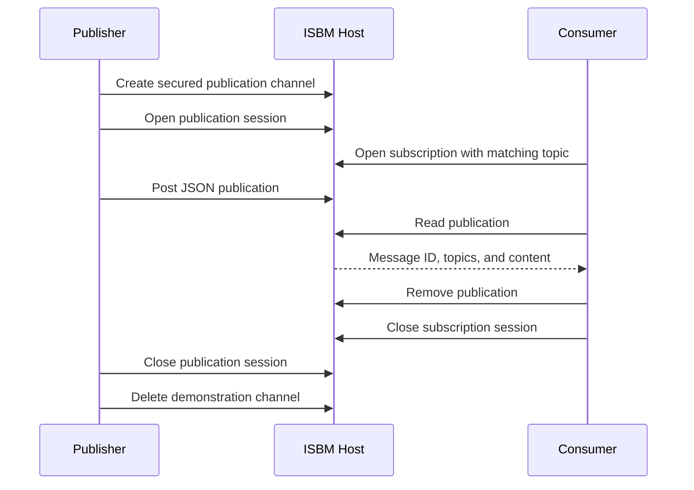

# Your First Message

Exchange an application-defined JSON publication between a publisher and a consumer. The payload is not CCOM; both applications agree on its meaning.

```json
{
  "equipmentId": "PUMP-101",
  "temperature": 72.5,
  "status": "Normal"
}
```

**Source-reviewed draft, not end-to-end validated:** expected routes, fields, and status codes below come from the current Host implementation. These commands have not been run against a live Host.

## Before You Begin

Complete [Installation](installation.md) and [Configuration](configuration.md). Leave the Host running at the HTTPS address you configured. Open two additional **PowerShell 7** windows, called **Publisher** and **Consumer** in this tutorial. Do not use Windows PowerShell 5.1: the helper uses PowerShell 7 HTTP status handling.

Use a dedicated development database and Service Bus namespace. The example creates a channel and broker entities, and its final cleanup deletes that channel. Your endpoint's certificate must be trusted; the example does not bypass certificate validation.

A channel identifies the exchange. A provider publication session lets the publisher submit messages. A consumer subscription session selects topics and provides a context for reading them.



The subscription must be opened **before** the publication is posted. Do not expect a new broker subscription to receive publications sent before it existed.

## 1. Prepare Both Client Windows

Run this entire block in **both** windows. Change the base URL consistently if you chose another port during installation.

Choose a new demonstration password at the prompt. Enter the **same username and password** in both windows. These are channel credentials you will create, not SQL Server or Azure credentials. Do not reuse infrastructure credentials.

```powershell
$ErrorActionPreference = 'Stop'
$IsbmBaseUrl = 'https://localhost:7443'
$IsbmTopic = 'equipment.temperature'
if ([uri]::new($IsbmBaseUrl).Scheme -ne 'https') {
    throw 'Use the trusted HTTPS endpoint configured for the Host.'
}

$IsbmCredential = Get-Credential -UserName 'demo-client' -Message 'Enter the same demonstration channel credentials in both windows'
if ($null -eq $IsbmCredential) { throw 'Credentials are required.' }
if ($IsbmCredential.UserName.Contains(':') -or
    [string]::IsNullOrWhiteSpace($IsbmCredential.UserName) -or
    [string]::IsNullOrEmpty($IsbmCredential.GetNetworkCredential().Password)) {
    throw 'Use a nonempty username without a colon and a nonempty password.'
}

$basicPair = '{0}:{1}' -f $IsbmCredential.UserName, $IsbmCredential.GetNetworkCredential().Password
$IsbmHeaders = @{
    Authorization = 'Basic ' + [Convert]::ToBase64String([Text.Encoding]::UTF8.GetBytes($basicPair))
    Accept = 'application/json'
}
Remove-Variable basicPair

function Invoke-Isbm {
    param(
        [Parameter(Mandatory)]
        [ValidateSet('Get', 'Post', 'Delete')]
        [string]$Method,
        [Parameter(Mandatory)]
        [string]$Path,
        [Parameter(Mandatory)]
        [int[]]$ExpectedStatus,
        [string]$Body
    )

    $request = @{
        Method = $Method
        Uri = "$IsbmBaseUrl/isbm/2.0/$Path"
        Headers = $IsbmHeaders
        ContentType = 'application/json; charset=utf-8'
        SkipHttpErrorCheck = $true
        StatusCodeVariable = 'isbmStatus'
        MaximumRedirection = 0
        ErrorAction = 'Stop'
    }
    if ($PSBoundParameters.ContainsKey('Body')) { $request.Body = $Body }

    $result = Invoke-RestMethod @request
    if ($ExpectedStatus -notcontains [int]$isbmStatus) {
        $errorSummary = if ($result.fault) {
            $result.fault
        } elseif ($result.title) {
            $result.title
        } else {
            'No ISBM fault name or problem title was returned.'
        }
        throw "Expected HTTP $($ExpectedStatus -join ' or '), received $isbmStatus; error: $errorSummary"
    }
    return $result
}
```

Basic authorization is Base64-encoded, not encrypted. HTTPS protects the exchange in transit. These variables contain usable credentials in memory; do not print the headers or channel-creation body, or capture them in shared transcripts.

In **Publisher**, check that the REST service responds:

```powershell
$discovery = Invoke-Isbm -Method Get -Path 'configuration/supported-operations' -ExpectedStatus 200
$discovery
```

A successful discovery response confirms that this route responds. It does not verify database or broker connectivity.

## 2. Create a Secured Publication Channel

In **Publisher**, create a unique channel and its credential together:

```powershell
$IsbmChannelUri = 'urn:rapidredpanda:demo:publication:' + [guid]::NewGuid().ToString('N')
$channelBody = @{
    uri = $IsbmChannelUri
    channelType = 'Publication'
    description = 'First-message demonstration'
    securityTokens = @(
        @{
            type = 'UsernameToken'
            username = $IsbmCredential.UserName
            password = $IsbmCredential.GetNetworkCredential().Password
        }
    )
} | ConvertTo-Json -Depth 10

$createdChannel = Invoke-Isbm -Method Post -Path 'channels' -Body $channelBody -ExpectedStatus 201
Remove-Variable channelBody
$IsbmChannelUri = $createdChannel.uri
if ([string]::IsNullOrWhiteSpace($IsbmChannelUri)) { throw 'No channel URI was returned.' }
$IsbmChannelRoute = [uri]::EscapeDataString($IsbmChannelUri)
Write-Host "Channel URI for Consumer: $IsbmChannelUri"
```

The expected response has `uri`, `channelType`, and `description`. The returned URI identifies this channel in later routes. It is not the internal GUID used for the Service Bus topic name.

The current Host supports `UsernameToken`. The token is created in the channel request; later protected calls supply matching HTTP Basic credentials. Do not create an unsecured channel and then try to secure it with AddSecurityToken: the current implementation rejects that transition.

## 3. Open the Publisher's Session

In **Publisher**:

```powershell
$providerSession = Invoke-Isbm -Method Post -Path "channels/$IsbmChannelRoute/publication-sessions" -ExpectedStatus 201
$providerSessionId = $providerSession.sessionId
if ([string]::IsNullOrWhiteSpace($providerSessionId)) { throw 'No provider session ID was returned.' }
Write-Host "Provider session: $providerSessionId"
```

This operation needs no JSON body. Capture the returned `sessionId`; it is distinct from the channel URI and from the message ID generated later.

## 4. Open the Consumer's Subscription

In **Consumer**, enter the channel URI displayed by Publisher:

```powershell
$IsbmChannelUri = (Read-Host 'Channel URI displayed by Publisher').Trim()
if ([string]::IsNullOrWhiteSpace($IsbmChannelUri)) { throw 'A channel URI is required.' }
$IsbmChannelRoute = [uri]::EscapeDataString($IsbmChannelUri)

$channel = Invoke-Isbm -Method Get -Path "channels/$IsbmChannelRoute" -ExpectedStatus 200
if ($channel.channelType -ne 'Publication') { throw 'This tutorial needs a Publication channel.' }

$subscriptionBody = @{ topics = @($IsbmTopic) } | ConvertTo-Json -Depth 10
$consumerSession = Invoke-Isbm -Method Post -Path "channels/$IsbmChannelRoute/subscription-sessions" -Body $subscriptionBody -ExpectedStatus 201
$consumerSessionId = $consumerSession.sessionId
if ([string]::IsNullOrWhiteSpace($consumerSessionId)) { throw 'No consumer session ID was returned.' }
Write-Host "Consumer ready: $consumerSessionId"
```

The subscription selects `equipment.temperature`. Topics are application-defined and case-sensitive in this implementation; use exactly the same topic in both windows.

This tutorial omits `listenerUrl` and uses polling. It also omits `filterExpressions`: the Host accepts structurally valid expressions but does not evaluate them. Topic selection still operates.

**Wait until Consumer displays its session ID before continuing in Publisher.**

## 5. Publish the JSON Message

In **Publisher**:

```powershell
$publicationBody = @{
    topics = @($IsbmTopic)
    messageContent = @{
        content = @{
            equipmentId = 'PUMP-101'
            temperature = 72.5
            status = 'Normal'
        }
    }
} | ConvertTo-Json -Depth 10

$postedPublication = Invoke-Isbm -Method Post -Path "sessions/$providerSessionId/publications" -Body $publicationBody -ExpectedStatus 201
$publishedMessageId = $postedPublication.messageId
if ([string]::IsNullOrWhiteSpace($publishedMessageId)) { throw 'No message ID was returned.' }
Write-Host "Published message: $publishedMessageId"
```

The request is an ISBM JSON envelope. Your application's JSON object belongs inside `messageContent.content`. For this **native JSON object**, omit `mediaType` and `contentEncoding`; the current mapper rejects those metadata fields for native object content.

The expected response supplies `messageId`. Keep that value to compare with the consumer's result; it is not a session ID.

The example omits `expiry` and relies on the configured broker's delivery lifetime. This does not promise indefinite retention. If supplied, `expiry` is a duration string parsed by the Host, such as `PT5M`, not a timestamp. Positive durations set a publication expiry; malformed durations are rejected. Expiration behavior has not been exercised here.

## 6. Read the Publication

In **Consumer**, poll for the message:

```powershell
$receivedPublication = $null
for ($attempt = 0; $attempt -lt 30; $attempt++) {
    $candidate = Invoke-Isbm -Method Get -Path "sessions/$consumerSessionId/publication" -ExpectedStatus @(200, 404)
    if ($candidate.fault -eq 'MessageFault') {
        Start-Sleep -Milliseconds 500
        continue
    }
    if ($candidate.fault) { throw "Read failed: $($candidate.fault)" }
    if ([string]::IsNullOrWhiteSpace($candidate.messageId)) {
        throw 'The read response did not contain a message ID.'
    }
    $receivedPublication = $candidate
    break
}
if ($null -eq $receivedPublication) {
    throw 'No publication arrived within the polling attempts. Check topic, subscription ordering, and Host errors.'
}
$receivedMessageId = $receivedPublication.messageId
Write-Host "Received message: $receivedMessageId"
$receivedPublication.topics
$receivedPublication.messageContent.content | ConvertTo-Json -Depth 10
```

A successful read is HTTP **200**, with `messageId`, `topics`, and `messageContent`. Compare the received ID with Publisher's displayed ID. The content should have `equipmentId` equal to `PUMP-101`, `temperature` equal to `72.5`, and `status` equal to `Normal`. These are expected values from the example, not a captured runtime response.

When no publication is available, this implementation returns HTTP **404** with `fault: "MessageFault"`, not HTTP 204. The loop retries only that fault; channel/session faults and other failures are not normal empty reads.

Each read can wait for the broker, so 30 attempts is not an exact wall-clock timeout. Reading does not remove the publication: the Host retains an outstanding broker delivery for that consumer session.

## 7. Remove the Consumed Publication

In **Consumer**, immediately after processing the content:

```powershell
$null = Invoke-Isbm -Method Delete -Path "sessions/$consumerSessionId/publication" -ExpectedStatus 204
```

RemovePublication acknowledges the outstanding delivery for this subscription session. The route has **no message ID**: the session identifies the publication currently being consumed. Do not substitute Publisher's session ID.

Remove promptly. The broker uses a delivery lock; this tutorial does not establish lock renewal, restart recovery, or multi-instance delivery guarantees.

## 8. Close Sessions and Clean Up

In **Consumer**:

```powershell
$null = Invoke-Isbm -Method Delete -Path "sessions/$consumerSessionId" -ExpectedStatus 204
Remove-Variable IsbmCredential, IsbmHeaders, subscriptionBody
```

Closing this subscription session also removes its Host-managed Service Bus subscription. Leave Publisher's window open until Consumer finishes.

Then in **Publisher**:

```powershell
$null = Invoke-Isbm -Method Delete -Path "sessions/$providerSessionId" -ExpectedStatus 204
```

Optionally remove **only the demonstration channel** you created:

```powershell
$null = Invoke-Isbm -Method Delete -Path "channels/$IsbmChannelRoute" -ExpectedStatus 204
```

Deleting a channel deletes its Host-managed broker topic. Do not delete another application's channel. Keep both session IDs until cleanup succeeds; if an earlier step failed, close only sessions that were successfully created, using this example's credentials.

After the final Publisher operation:

```powershell
Remove-Variable IsbmCredential, IsbmHeaders, publicationBody
```

Closing sessions releases messaging contexts; it is separate from removing a consumed message and deleting the channel.

## Operation Checklist

All statuses in this table are **source-derived expectations**, not live test results. Protected channel and session operations use the matching Basic authorization header. JSON request bodies use `Content-Type: application/json`.

| Operation | Method and path after `/isbm/2.0/` | Body | Expected status |
| --- | --- | --- | --- |
| Discovery | GET `configuration/supported-operations` | None | 200 |
| Create secured channel | POST `channels` | URI, Publication type, description, securityTokens | 201 |
| Verify channel | GET `channels/{channelUri}` | None | 200 |
| Open provider | POST `channels/{channelUri}/publication-sessions` | None | 201 |
| Open consumer | POST `channels/{channelUri}/subscription-sessions` | topics | 201 |
| Post | POST `sessions/{providerSessionId}/publications` | topics, messageContent.content | 201 |
| Read | GET `sessions/{consumerSessionId}/publication` | None | 200; 404 MessageFault when empty |
| Remove | DELETE `sessions/{consumerSessionId}/publication` | None | 204 |
| Close either session | DELETE `sessions/{sessionId}` | None | 204 |
| Delete demo channel | DELETE `channels/{channelUri}` | None | 204 |

## Troubleshooting

| Symptom | Check |
| --- | --- |
| TLS or connection failure | Host address, port, trusted certificate, and whether the Host is still running. Do not disable TLS validation to hide the problem. |
| HTTP 400 with an HTTPS-required problem title | When IsTlsEnabled is true, the Host rejects non-HTTPS ISBM requests before redirects or operations. Use the trusted HTTPS address; for proxy termination, validate trusted scheme handling. This is ProblemDetails, not ParameterFault. |
| HTTP 400 ParameterFault | Envelope shape, JSON content type, topic values, and any expiry duration. Native JSON content must be inside messageContent.content without mediaType or contentEncoding. |
| HTTP 404 ChannelFault or SessionFault | URI/ID, session lifetime, and matching credentials. The Host can hide unauthorized resources behind these faults; do not assume every authentication failure returns 401. |
| HTTP 404 MessageFault | Consumer subscription opened before posting, identical topic spelling/case, successful post, and delivery lifetime. This fault alone is a normal empty read. |
| HTTP 409 | Existing channel URI or conflicting/unsupported token configuration. Use a new demonstration URI; do not delete an unfamiliar existing channel. |
| HTTP 422 OperationFault | A route was called with the wrong kind of session. Provider and consumer IDs are not interchangeable. |
| HTTP 500 OperationFault | SQL configuration/access, Service Bus namespace permissions/connectivity, and sanitized Host logs. Do not share secrets from configuration or request headers. |

Do not blindly retry a failed publish: the source sends to the broker before recording publication metadata in SQL, so an error after sending may still have delivered a message. Retries can create duplicates.

For complete contracts and lifecycle boundaries, see [Publication / Subscription](../api/publication-workflow.md), [Fault Handling](../api/fault-handling.md), and [Compatibility and Limitations](../api/compatibility-and-limitations.md).

For setup details, return to [Installation](installation.md), [Configuration](configuration.md), or the [Getting Started index](README.md). PowerShell HTTP behavior is described in Microsoft's [Invoke-RestMethod documentation](https://learn.microsoft.com/en-us/powershell/module/microsoft.powershell.utility/invoke-restmethod?view=powershell-7.5).

