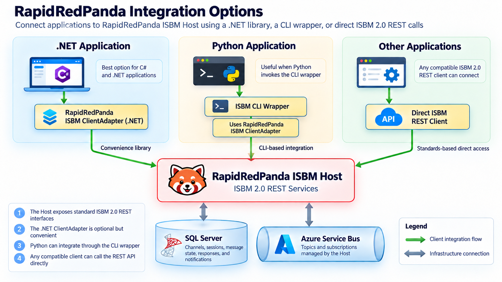

# Integration Options

Applications communicate with RapidRedPanda ISBM Host through the OpenO&M ISBM 2.0 REST interfaces. You can call those REST interfaces directly, or use optional client-side tools that wrap the same contracts.

The diagram is conceptual. All three approaches ultimately use the Host's ISBM REST interfaces. The .NET ClientAdapter and CLI Wrapper are optional external components with their own versions, licenses, and documentation; they are not included in the Host distribution. Python applications can invoke the CLI with `subprocess`, but they can also call the REST API directly. Published packages and documentation do not, by themselves, establish completed compatibility testing against the current Host staging release.

## Choose an Approach

| Approach | Best fit | Basic example |
| --- | --- | --- |
| .NET ClientAdapter | C# and .NET applications that want service classes instead of hand-written HTTP calls. | [Publish with the .NET ClientAdapter](dotnet-clientadapter.md) |
| CLI Wrapper | Automation, shell scripts, Python subprocess integration, and command-driven applications that want JSON command output. | [Open a subscription with the CLI Wrapper](cli-wrapper.md) |
| Direct REST API | Any language or tool that can issue HTTPS requests. | [Call the REST discovery endpoint](direct-rest.md) |

## Authoritative References

- [.NET ClientAdapter Coding Guide](https://github.com/claire-wong/RapidRedPanda.ISBM.ClientAdapter.SDK.Samples/blob/main/Documents/RapidRedPanda-ISBM-Coding-Guide.md)
- [RapidRedPanda ISBM Wrapper](https://github.com/claire-wong/RapidRedPanda-ISBM-Wrapper)
- [Wrapper Python samples](https://github.com/claire-wong/RapidRedPanda-ISBM-Wrapper/tree/main/samples/python)
- [Host REST API overview](../api/overview.md)

For a complete direct REST walkthrough, start with [Your First Message](../getting-started/first-message.md). Return to the [documentation index](../README.md).