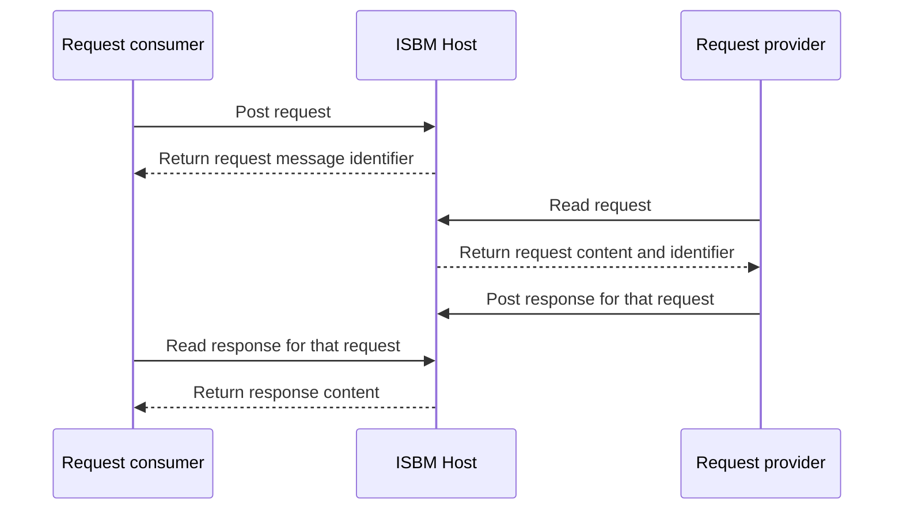

# Core Concepts

This page introduces the vocabulary used by ISBM clients and explains the current RapidRedPanda behavior where it matters. Examples are conceptual, not complete REST request payloads.

## Channel

A channel identifies a place for related message exchanges. Its type determines whether it supports publications or requests. An integration might use one publication channel for equipment events and a separate request channel for equipment queries.

RapidRedPanda supports creating, listing, retrieving, and deleting channels, along with adding and removing channel security tokens. An ISBM channel identifier is part of the application interface; it is not an Azure Service Bus entity name that clients must manage.

## Provider and Consumer

These roles describe the application's part in an exchange. One application can play several roles.

| Exchange | Provider | Consumer |
| --- | --- | --- |
| Publication | Publishes information. | Subscribes to and reads information. |
| Request/response | Receives a request and provides a response. | Sends a request and reads responses. |

In particular, a request **consumer sends the request** because it consumes the answering service. A request **provider receives the request** because it provides that service.

## Publication and Subscription

A publication is a message a provider shares. A subscription records a consumer's interest in selected topics on a publication channel.

For example, a monitoring application publishes an update labeled `equipment.status`. A dashboard opens a subscription session selecting that topic and reads eligible publications through the Host.

In RapidRedPanda, reading and removing a publication are separate operations. Removing an outstanding publication advances that subscription's consumption; it does not mean every other subscriber has processed the message.

## Request and Response

A request asks for information or an action. A response is a separate message associated with the original request's identifier.

Consider a reporting application asking for an equipment summary. It uses the Consumer Request Service. The application supplying the summary uses the Provider Request Service.

This shows the business exchange through the Host, not every authentication, removal, or session operation. The requester can retrieve an answer later; an HTTP acknowledgement of the posted request is not the business response.

## Session

A session provides an identified context for messaging operations on a channel. Applications open the kind of session appropriate to their role and use its identifier in subsequent operations.

RapidRedPanda has publication, subscription, provider request, and consumer request sessions, with an operation to close sessions. A session is Host-managed state rather than a continuously open HTTP connection. Session identifiers should be handled carefully; they do not replace credentials on secured channels.

## Topic

A topic is a label used to select messages within a channel. For example, `equipment.status` and `equipment.alert` could distinguish two kinds of equipment events.

RapidRedPanda matches logical topics using exact, case-sensitive values. A publication is eligible when at least one of its topics matches a subscription's selected topics. Providers receiving requests also select topics.

An ISBM topic label is distinct from an Azure Service Bus topic entity. Clients supply logical labels; the Host manages the broker mapping.

## Security Token

A channel security token supplies credentials used to control access to a secured channel. The ISBM 2.0 specification uses the term [`UsernameToken`](https://www.openoandm.org/files/standards/ISBM-2.0.pdf), including in section 7.19. This is the term used by the current Host.

RapidRedPanda supports `UsernameToken` entries containing a username and password. Its REST operations parse HTTP Basic credentials to check channel and session access.

For a supplied flat token entry, omitting the `type` field defaults that entry to `UsernameToken`; username and password are still required. Omitting the entire `securityTokens` collection produces no token entries. It does not generate a username, password, or default identity. Channel access behavior depends on whether the channel has active tokens.

The available token handling is not a statement of production security readiness. Transport protection and the Host's reported security configuration need deployment review before production use.

## Filter Expression

A filter expression describes a content-based selection condition. Conceptually, it could ask for messages whose payload indicates a critical condition. This differs from selecting the message's topic label.

**Filter expressions are accepted for compatibility, but are not applied by the server in this release.**

RapidRedPanda validates the supplied expression structure and stores valid expressions for subscription and provider request sessions. Invalid structures can cause a validation fault. The Host does not evaluate the expressions against message content, and configuration discovery reports XML and JSON filtering as disabled.

Topic selection remains active. A client requiring content filtering must examine retrieved messages itself and follow the normal consumption lifecycle even for messages it chooses to discard. A content filter must not be relied on as an access-control boundary.

## Notification

A notification tells a listening application that a message is available. It is an availability signal, not delivery of the full business payload.

RapidRedPanda can call a listener URL supplied when opening a subscription, provider request, or consumer request session. Its notification pipeline supports publication, request, and response notifications. The receiving application then uses the appropriate REST read operation to retrieve content.

Applications can also poll for messages without a listener. Notification delivery includes retries and does not guarantee exactly-once delivery; listeners must tolerate repeated signals and availability changing before a read.

## Putting the Concepts Together

For a publication exchange, a provider opens a publication session on a channel and posts a message with topics. A consumer opens a subscription session selecting topics, reads eligible publications, and removes each outstanding publication after processing it. A listener can signal availability, and channel credentials control access where tokens are configured.

For request/response, a consumer opens a request session and posts a request with topics. A provider opens its request session selecting topics, reads requests, and posts responses linked to request identifiers. The consumer retrieves those responses.

These are learning examples. Detailed payloads, lifecycle rules, faults, and deployment instructions require the later API and operational documentation.

Previous: [ISA-95 and ISBM](isa95-and-isbm.md). Introduction: [What Is ISBM?](what-is-isbm.md). Project: [RapidRedPanda ISBM Host](../../README.md).
