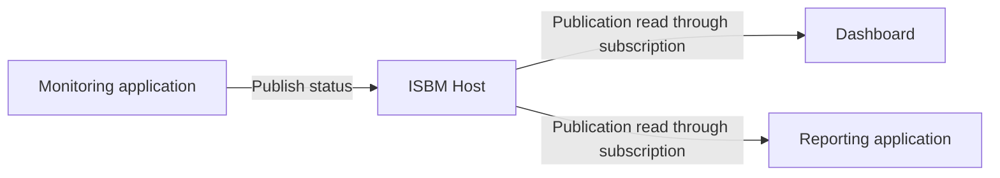

# What Is ISBM?

ISBM gives applications a common way to exchange messages through a messaging service. A client can publish information, subscribe to selected topics, send a request, or retrieve a response using defined interfaces rather than a separate messaging API for every integration.

[OpenO&M publishes ISBM](https://www.openoandm.org/isbm/) as an implementation specification for the ISA-95 Messaging Service Model. RapidRedPanda ISBM Host implements server-side REST services for these exchanges.

## The Integration Problem

Imagine a monitoring application that reports equipment conditions. A dashboard needs updates, a maintenance application needs alerts, and an analysis application needs observations. Direct connections to all three receivers require the monitoring application to understand their individual interfaces.

With a messaging service, the monitoring application posts messages to an agreed channel. Receiving applications subscribe to relevant topics. This gives the participants a common messaging interface and reduces the publisher's need to know each receiver.

The participants still agree on what an equipment identifier means, which measurement units they use, and how message content is structured. Messaging services carry that agreement; they do not create it.

## What ISBM Standardizes

ISBM defines application-facing operations and structures for exchanging messages. It provides a shared vocabulary for channels, sessions, publications, requests, responses, and related service behavior.

In practice, a developer learns how to open the appropriate session, submit or retrieve messages, and manage their lifecycle. A particular implementation determines how it stores state and connects those operations to its underlying infrastructure.

## Publication/Subscription

A publication shares information with interested consumers. The publisher does not ask each consumer for a reply.

For example, a monitoring application publishes an equipment-status message with the topic `equipment.status`. A dashboard and a reporting application each open subscription sessions selecting that topic. They read eligible publications through the Host.

The arrows describe information flow. In RapidRedPanda, consumers retrieve message content through REST read operations; a notification callback can signal that a message is available.

## Request/Response

A request asks another application to supply information or perform work. A response refers back to that request.

For example, an application requests an equipment summary. A responding application receives the request, prepares a summary, and posts a response linked to the request's message identifier. The requesting application retrieves the response later.

This is an application message exchange. Receiving an HTTP response confirming that the Host accepted a request is distinct from receiving the responding application's business answer.

In ISBM terminology, the **Consumer Request Service** serves the requesting application, and the **Provider Request Service** serves the responding application. [Core Concepts](core-concepts.md) explains these roles.

## ISBM and a Messaging Broker

A messaging broker provides infrastructure for moving messages. For example, [Azure Service Bus](https://learn.microsoft.com/en-us/azure/service-bus-messaging/service-bus-messaging-overview) provides queues, topics, and subscriptions.

ISBM specifies the services applications use. RapidRedPanda translates its REST operations into Host state management and broker operations. A client identifies ISBM channels, topics, and sessions rather than selecting Azure entities directly.

RapidRedPanda currently requires SQL Server and Azure Service Bus. The separation between an application-facing specification and a broker does not mean this Host already supports other brokers.

## Use Beyond Manufacturing

These patterns also appear in other settings: an inventory application announces stock changes, a reporting application requests a summary, or several applications receive status updates. This is a practical reason to consider ISBM even when a project is outside manufacturing or is not part of an OpenO&M ecosystem.

Whether ISBM is appropriate depends on the integration's needs and the clients' ability to use its interfaces. It does not eliminate payload agreements, security design, or operational planning.

## RapidRedPanda's Current Scope

The Host includes REST channel and session management, publication/subscription, request/response, configuration discovery, and optional availability notifications. Its supported channel token is `UsernameToken`.

Filter expressions are accepted for compatibility, but are not applied by the server in this release. Expressions must pass structural validation; topic selection still controls eligibility. Applications needing content selection must apply it after retrieving messages.

The ISBM specification includes REST and SOAP definitions, but the current Host documentation describes REST support only. These pages do not claim full specification compliance.

Continue with [ISA-95 and ISBM](isa95-and-isbm.md), then [Core Concepts](core-concepts.md). Return to the [project overview](../../README.md) for capabilities and documentation status.
